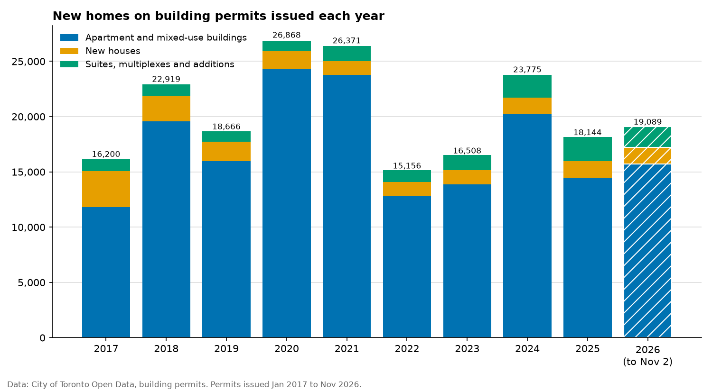

# Toronto building permits: where new homes are approved, and how long it takes

Toronto has a housing shortage, and every new home starts with a building permit. This project
uses the City of Toronto's own permit records to answer three questions: how many new homes the
city has approved each year since 2017, where they are, and how long it takes to get a permit.
It writes the answers up as a [report](report/REPORT.md) with tables and charts.

Along the way it found a problem in the data itself: since mid-2025 the city has been closing
out old permits in bulk, so the "completed" date can't be trusted as a sign that construction
finished. The report explains how it was detected and works around it.

## Results

<!-- results:start -->
_Permits issued Jan 2017 to Nov 2026. Full report: [report/REPORT.md](report/REPORT.md)._

- **Toronto issued building permits for 203,696 new homes** from Jan 2017 to Nov 2026. Those projects remove 12,564 existing homes, so the net gain is 191,132.
- **2020 was the busiest year (26,868 homes) and 2022 the quietest (15,156).** 2025, the latest full year, had 18,144: 12% below the 2017–2025 average of 20,512.
- **85% of the new homes are in apartment and mixed-use buildings.** New houses account for 8%.
- **Small-scale housing grew:** permits for suites, multiplexes and additions added 2,181 homes in 2025, 1.9 times the 1,129 in 2017.


<!-- results:end -->

## Questions it answers

| Question | How |
|---|---|
| How many new homes are being approved? | "Dwelling units created" on every permit issued each year, minus homes demolished |
| What kind of projects? | Apartment and mixed-use buildings, new houses, and suites, multiplexes and additions |
| Where? | Totals by postal area (the first three characters of a postal code) |
| How long does a permit take? | Days from application to issue, median and 90th percentile, by permit type and year |
| Can the completion dates be trusted? | Monthly closings and the age of permits when closed, with automatic detection of a sustained jump |

## Run it

Needs Python 3.11 or newer and about 250 MB of disk space for the downloaded files.

```bash
python -m venv .venv && source .venv/bin/activate
pip install -e '.[dev]'
python -m permits            # downloads both files, writes report/ and updates the results above
python -m permits --refresh  # download again; the city updates the files daily
pytest                       # tests use small made-up files and don't need the internet
```

## How it works

```
src/permits/
  sources.py    download the two files from Toronto Open Data; read only the needed columns
  clean.py      combine the files, remove duplicates and revisions, log every row dropped
  analysis.py   homes by year and area, approval times, the closing trend and the jump detector
  report.py     findings, tables and the Markdown report
  charts.py     the four charts
docs/WALKTHROUGH.md   plain-language explanation of every step and design choice
```

- **Two files combined.** The city publishes closed permits and open permits separately. Using
  only closed permits would make recent years look faster than they were, because slow permits
  aren't closed yet. Together the two files contain every permit issued since 2017.
- **Every dropped row is accounted for.** The report has a table of each cleaning step and how
  many rows it removed.
- **Every sentence in the findings is calculated**, so re-running on newer data can't leave a
  stale claim behind.
- **No personal data.** Street addresses, descriptions and builder names (some builders are
  individuals) are never read from the files, and results are only shown as totals by area.

## Data

| Data | Source | Licence |
|---|---|---|
| Building Permits – Cleared Permits (since 2017) | [Toronto Open Data](https://open.toronto.ca/dataset/building-permits-cleared-permits/) | Open Government Licence – Toronto |
| Building Permits – Active Permits | [Toronto Open Data](https://open.toronto.ca/dataset/building-permits-active-permits/) | Open Government Licence – Toronto |

The downloaded files are cached in `data/raw/` and not committed.

## Limitations

- **Approved isn't built.** Homes are counted when the permit is issued. Some will never be built.
- **"Dwelling units created" comes from the application** and isn't checked against the result.
- **16% of approved homes have no postal code**, mostly on large apartment permits, so areas with
  big new developments are undercounted in the "where" table.
- **Approval time includes the applicant's own time** answering the city's comments.

## How this was built

AI-assisted: the code, tests and write-up were produced with Claude Code, then reviewed. The
commits say so with a `Co-Authored-By` line.

## Licence

MIT. Contains information licensed under the Open Government Licence – Toronto.
