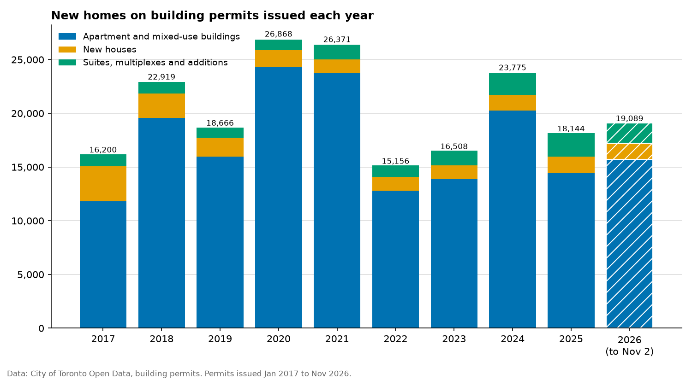
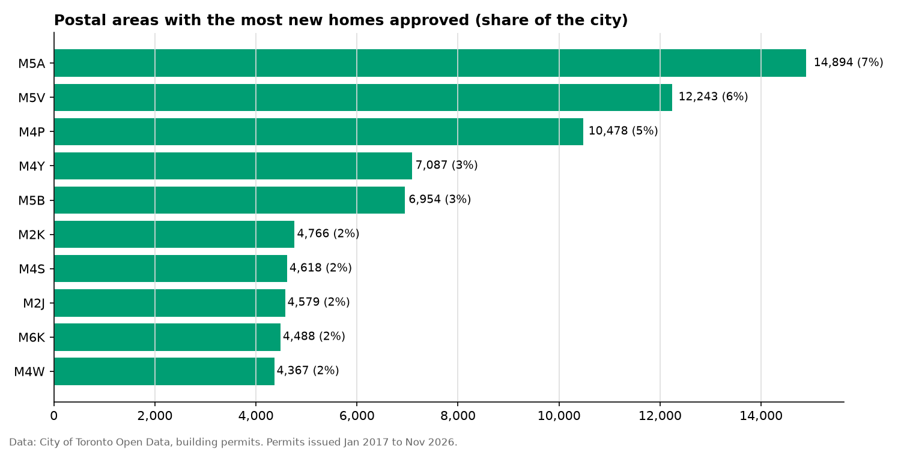
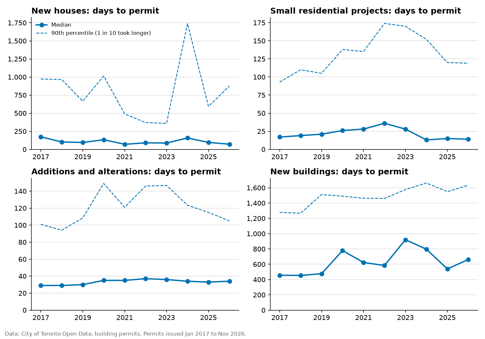
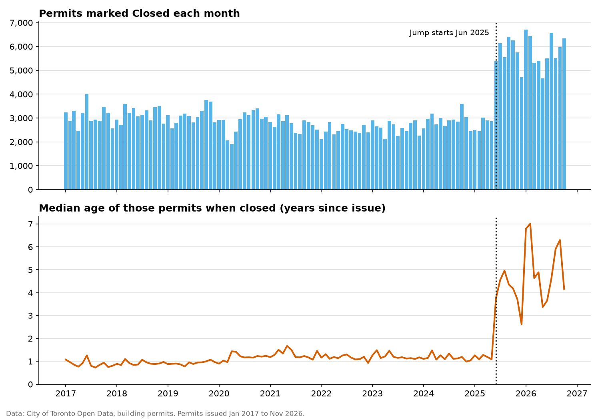

# Toronto building permits: where new homes are approved, and how long it takes

Building permits issued by the City of Toronto from Jan 2017 to Nov 2026. 2026 is a partial year (to Nov 2). Generated with
`python -m permits`. Data downloaded Nov 3, 2026.

## Key findings

- **Toronto issued building permits for 203,696 new homes** from Jan 2017 to Nov 2026. Those projects remove 12,564 existing homes, so the net gain is 191,132.
- **2020 was the busiest year (26,868 homes) and 2022 the quietest (15,156).** 2025, the latest full year, had 18,144: 12% below the 2017–2025 average of 20,512.
- **85% of the new homes are in apartment and mixed-use buildings.** New houses account for 8%.
- **Small-scale housing grew:** permits for suites, multiplexes and additions added 2,181 homes in 2025, 1.9 times the 1,129 in 2017.
- **M5A had the most new homes approved: 14,894, or 7% of the city.** The ten busiest postal areas (out of about 98) account for 37%.
- **16% of new homes (32,806) have no postal code**, 88% of them on 84 permits for 100 or more homes. Areas with large new developments are probably undercounted.
- **From application to permit**, new houses took a median of 96 days in 2025, faster than 173 days in 2017; new buildings took a median of 539 days in 2025, slower than 456 days in 2017.
- **From June 2025, the city closed far more permits than usual**: 5,800 a month against a typical 2,962. The median permit closed in that time was 4.5 years old, against 1.1 before. This looks like old paperwork being cleared, so **completion dates since then don't show when buildings were finished**, and this report doesn't use them to count homes.

## New homes approved each year

Homes are counted when the permit is **issued**, from the permit's "dwelling units created" field.
Permits later cancelled or revoked are left out.

| Year | Apartment and mixed-use buildings | New houses | Suites, multiplexes and additions | Total | Demolished | Net new homes |
|---|---|---|---|---|---|---|
| 2017 | 11,793 | 3,278 | 1,129 | 16,200 | 1,351 | 14,849 |
| 2018 | 19,566 | 2,286 | 1,067 | 22,919 | 1,360 | 21,559 |
| 2019 | 15,978 | 1,771 | 917 | 18,666 | 1,210 | 17,456 |
| 2020 | 24,302 | 1,602 | 964 | 26,868 | 1,323 | 25,545 |
| 2021 | 23,763 | 1,241 | 1,367 | 26,371 | 1,573 | 24,798 |
| 2022 | 12,812 | 1,287 | 1,057 | 15,156 | 1,105 | 14,051 |
| 2023 | 13,883 | 1,293 | 1,332 | 16,508 | 1,641 | 14,867 |
| 2024 | 20,269 | 1,465 | 2,041 | 23,775 | 885 | 22,890 |
| 2025 | 14,456 | 1,507 | 2,181 | 18,144 | 1,041 | 17,103 |
| 2026 (to Nov 2) | 15,731 | 1,501 | 1,857 | 19,089 | 1,075 | 18,014 |
| **All years** | **172,553** | **17,231** | **13,912** | **203,696** | **12,564** | **191,132** |

- **Apartment and mixed-use buildings** are "New Building" permits.
- **Suites, multiplexes and additions** are "Small Residential Projects" and "Building
  Additions/Alterations" permits: second units, laneway and garden suites, multiplexes and extensions.
- **Demolished** counts the existing homes these projects remove.

## Where

Postal areas are the first three characters of a postal code (for example M5V). Canada Post
calls them forward sortation areas.

| Postal area | New homes approved | Share of city |
|---|---|---|
| M5A | 14,894 | 7.3% |
| M5V | 12,243 | 6.0% |
| M4P | 10,478 | 5.1% |
| M4Y | 7,087 | 3.5% |
| M5B | 6,954 | 3.4% |
| M2K | 4,766 | 2.3% |
| M4S | 4,618 | 2.3% |
| M2J | 4,579 | 2.2% |
| M6K | 4,488 | 2.2% |
| M4W | 4,367 | 2.1% |

32,806 homes are on permits with no postal code and aren't in this table. Most are
on large apartment permits, often for sites that don't have a postal code yet, so areas with big
new developments are undercounted. The shares are of all homes approved, including these.

## How long permits take

Days from **application** to **permit issued**, for permits issued each year: the median, then
the 90th percentile in brackets (one permit in ten took longer than this).

| Year issued | New houses | Small residential projects | Additions and alterations | New buildings |
|---|---|---|---|---|
| 2017 | 173 (973) | 17 (93) | 29 (101) | 456 (1,277) |
| 2018 | 102 (965) | 19 (110) | 29 (94) | 454 (1,267) |
| 2019 | 95 (666) | 21 (105) | 30 (108) | 477 (1,511) |
| 2020 | 133 (1,014) | 26 (138) | 35 (149) | 779 (1,491) |
| 2021 | 70 (491) | 28 (135) | 35 (121) | 623 (1,463) |
| 2022 | 90 (370) | 36 (174) | 37 (146) | 584 (1,461) |
| 2023 | 88 (360) | 28 (170) | 36 (147) | 920 (1,576) |
| 2024 | 157 (1,738) | 13 (152) | 34 (123) | 797 (1,662) |
| 2025 | 96 (594) | 15 (120) | 33 (115) | 539 (1,549) |
| 2026 (to Nov 2) | 71 (876) | 14 (119) | 34 (105) | 662 (1,633) |

Large projects can start early on a separate "conditional" permit, so for new buildings the wait
for the full permit overstates how long work is held up.

## A permit-closing clean-up

| Year | Permits closed | Median age when closed (years) |
|---|---|---|
| 2017 | 37,083 | 0.9 |
| 2018 | 37,993 | 0.9 |
| 2019 | 37,299 | 0.9 |
| 2020 | 34,309 | 1.2 |
| 2021 | 33,035 | 1.3 |
| 2022 | 29,821 | 1.2 |
| 2023 | 31,101 | 1.2 |
| 2024 | 34,875 | 1.1 |
| 2025 | 53,911 | 3.2 |
| 2026 | 58,428 | 4.8 |

A sustained jump means at least three months in a row with 1.5 times the typical monthly
closings (the median of the first five years).

## How the data was cleaned

| Step | Rows |
|---|---|
| Rows read from both files | 648,406 |
| Dropped: revisions to an earlier permit (they repeat its details) | 67,070 |
| Dropped: the same permit listed twice | 23 |
| Dropped: not issued (still under review, refused before issue, or no date) | 45,328 |
| Dropped: issued before Jan 1, 2017 or after Nov 2, 2026 | 174,924 |
| Kept, but no approval time: application date missing or after the issue date | 6 |
| Permits analysed | 361,061 |

## Method and limitations

- **Two files, combined.** The city publishes closed permits and open permits separately. Every
  permit issued since January 2017 is in one or the other, so together they show all permits
  issued, finished or not.
- **Homes are counted at approval, not completion.** Some approved homes will never be built,
  and big projects take years. The completion date isn't used, because of the clean-up above.
- **"Dwelling units created" is filled in from the application.** It's the city's best record,
  but it isn't checked against what was finally built.
- **Approval time runs from the application date to the issue date.** It includes time the
  applicant took to answer the city's comments, not just the city's own review time.
- **No personal data is used.** Street addresses and builder names are never read from the files.
